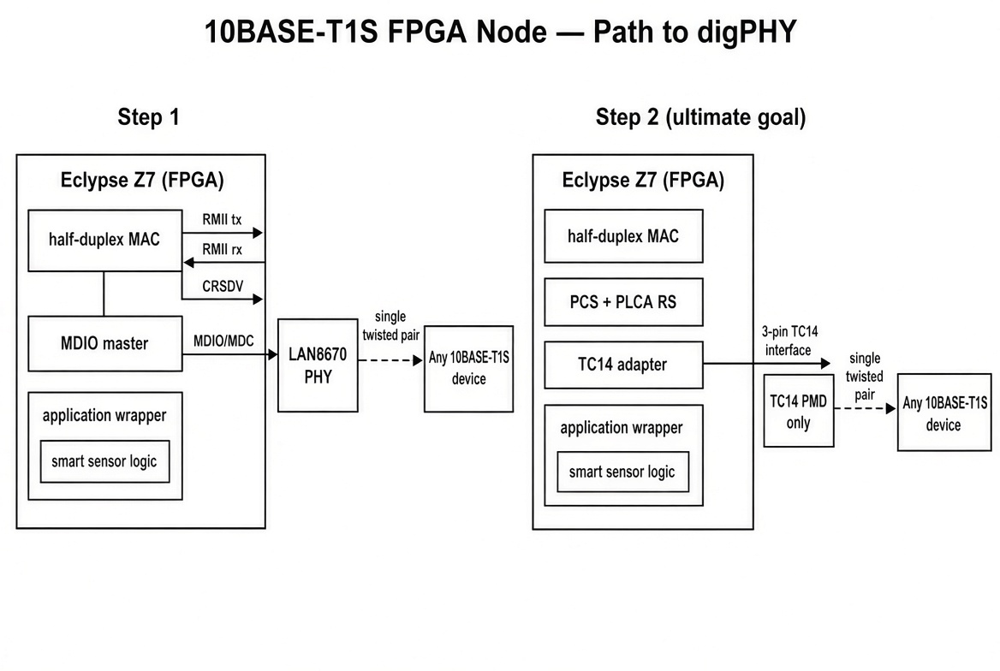

# Open Single Pair Ethernet

## Introduction

The worlds of networking and FPGA design have become increasingly intertwined. Modern FPGAs are now powering everything from high-speed network interfaces to complex packet processing pipelines and industrial automation systems.

Single Pair Ethernet (IEEE 802.3cg 10BASE-T1S) provides a simple, deterministic multidrop bus for distributed embedded systems. It carries data (and optionally power) over a single twisted pair, making it well-suited for industrial, automotive, and edge sensor networks without need of a Switch.

The plan is to start with a reconfigurable 10BASE-T1S MAC driving an external PHY and finally move the digital PHY into the FPGA.

## Roadmap

### Step 1 

External PHY (now). Half-duplex MAC + MDIO + RMII to a LAN8670 on an Eclypse Z7 with SYZYGY breakouts. Validates PLCA, mixing-segment behaviour, and a thin application wrapper for smart-sensor logic. Uses open tooling (e.g. liteeth).

### Step 2

DigPHY- Same MAC and wrapper. New RTL implements Clause 147 PCS, Clause 148 PLCA, and the [OPEN Alliance TC14 3-pin interface](https://opensig.org/wp-content/uploads/2024/01/OPEN_Alliance_10BASE-T1S_PMD_Transceiver_Interface_1p5_Final.pdf). The external part shrinks to any TC14-compliant PMD (e.g. TJA1410). Vendor-agnostic digital side.
